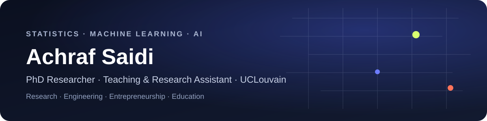

# Achraf Saidi

I am a **PhD Researcher and Teaching & Research Assistant at UCLouvain (ISBA / LIDAM)**, working across statistics and machine learning. My main research interests include **calibration, survival analysis, statistical learning and reliable prediction**, while my broader technical interests span deep learning, world models, optimization and modern AI systems.

I like working at the point where mathematical ideas, data and software meet: understanding a problem carefully, building the right model, and turning it into something useful.

## Current roles

| | Role | Focus |
|---|---|---|
| **UCLouvain · ISBA / LIDAM** | **PhD Researcher & Teaching Assistant** | Statistics, machine learning, research and teaching |
| **NovalisAI** | **Co-founder & CTO** | Applied AI, data products, automation and software systems |
| **NUMERIA** | **Co-founder & CEO — building** | Exact sciences, programming, data and AI education |
| **Jet Things · Jet Next** | **Associate** | Software, AI and digital transformation in Algeria |

### NovalisAI

At **NovalisAI**, I work on the technical direction of applied AI and software projects: from data and workflow analysis to machine-learning systems, automation and product engineering.

### NUMERIA

I am building **NUMERIA**, an online education initiative originating in Algeria and focused on **mathematics, exact sciences, programming, data science and artificial intelligence**.

The long-term idea is bigger than a catalogue of courses: build a rigorous path that can take a learner **from first principles to real technical competence** — whether that means becoming a data scientist, ML engineer, developer or simply developing a strong scientific foundation.

A central part of the mission is **accessibility**: a substantial open-access layer of high-quality educational material for learners in Africa and other underserved regions, alongside live cohorts, mentoring and advanced paid programs whose pricing can be adapted to local contexts.

> NUMERIA is currently under construction. Its public educational catalogue and learning platform will expand progressively.

## Research & technical interests

`Statistics` · `Machine Learning` · `Deep Learning` · `Survival Analysis` · `Calibration` · `Bayesian Statistics` · `Optimization` · `Reinforcement Learning` · `World Models` · `LLMs` · `Computer Vision` · `Data Engineering`

## Selected experience

- **Luminus** — battery-storage data analysis and optimization in electricity markets.
- **Sonatrach** — designed and developed a substantial project-management software system.
- **Public-sector NLP / LLM work** — evidence-grounded language-processing pipelines and local language-model workflows.
- **Biomedical data** — cancer-data exploration, predictive modelling and medical-data projects.
- **Computer vision** — supervised and self-supervised image segmentation and representation learning.
- **Enterprise software** — operational tools, ERP-style systems and digital-transformation projects.

Most industrial and research repositories remain private when they involve confidential data, client systems or unpublished work.

## Teaching

At UCLouvain, I contribute to teaching in **statistics, R programming and quantitative methods**. I also enjoy explaining machine learning, data science and programming from first principles.

## Building in public

I am expanding this GitHub with self-contained technical projects covering:

- exploratory data analysis and scientific visualization;
- classical machine learning and model evaluation;
- deep learning and representation learning;
- time series and forecasting;
- reinforcement learning and sequential decision-making;
- Bayesian and causal modelling;
- graph machine learning;
- LLM / retrieval evaluation;
- optimization and decision-support systems.

The goal is not to collect toy repositories, but to document complete, reproducible workflows.

## Links & contact

- **Website:** [achraf-saidi.github.io](https://achraf-saidi.github.io)
- **LinkedIn:** [Achraf Saidi](https://be.linkedin.com/in/achraf-saidi-b141b8247)
- **Academic / research / teaching:** **mohamed.a.saidi@uclouvain.be**
- **NovalisAI / data / ML / AI projects:** **achraf@novalisai.com**
- **NUMERIA:** **Achraf@numeria.dz**
